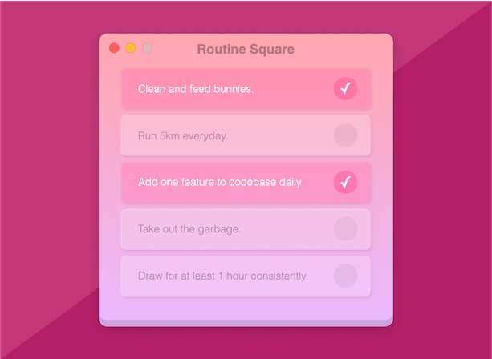
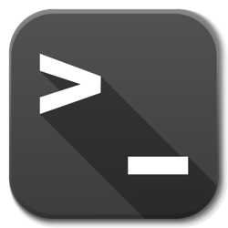

   
<b>Routine Square</b>

 

### Features
- Interactive checklist of 5 key daily tasks.
- Interactive checkmarks. 
- Opens in upper right of screen.
- Automatically resets checkmarks at midnight
 

### Languages/Frameworks
&nbsp;&nbsp;&nbsp;&nbsp;&nbsp;&nbsp;&nbsp;&nbsp;&nbsp;&nbsp;&nbsp;&nbsp;&nbsp;&nbsp;&nbsp;&nbsp;&nbsp;&nbsp;&nbsp;&nbsp;&nbsp;&nbsp;&nbsp;&nbsp;&nbsp;

 

### Project Files 
[Routine Square Source Files](https://github.com/MichaelTroeung/Routine-Square/tree/main)&nbsp;&nbsp;&nbsp;&nbsp;&nbsp;&nbsp;&nbsp;&nbsp;&nbsp;&nbsp;

